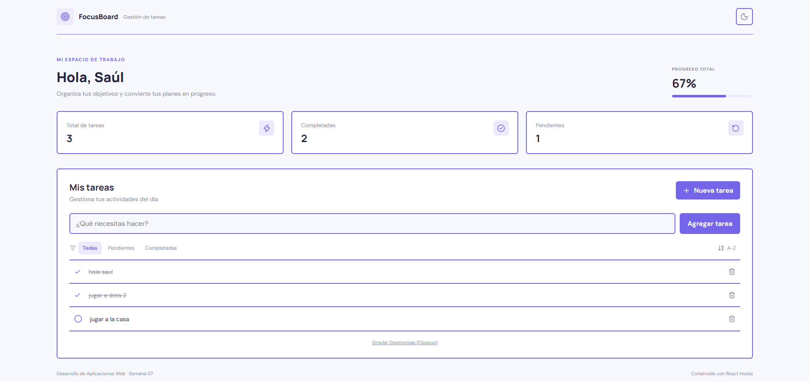
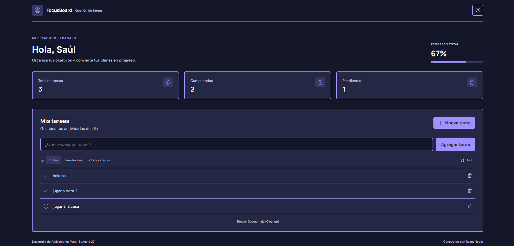
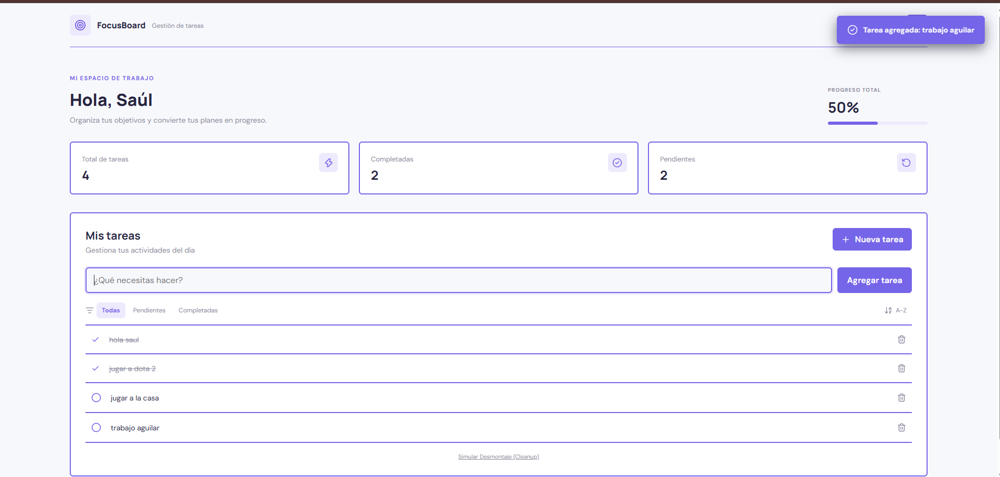

# Semana 07 - Dashboard de Gestión con React Hooks

**Alumno:** Pariona Ramos Saul Anibal  
**Universidad:** Universidad Nacional del Centro del Perú (UNCP)  
**Facultad:** Ingeniería de Sistemas  
**Asignatura:** Desarrollo de Aplicaciones Web (IS093A)  
**Guía práctica:** Semana 07 - Segunda parte

## Repositorio

Repositorio en GitHub:

<https://github.com/saulPariona/Semana-7-Aguilar-parte-2.git>

## Descripción

Este proyecto es un dashboard de gestión de tareas desarrollado con React, TypeScript, Vite y React Hooks. Permite crear, completar, eliminar, filtrar y ordenar tareas. También incluye persistencia con `localStorage`, cambio de tema claro y noche, auto-focus del formulario y alertas visibles para las acciones principales.

## Tecnologías utilizadas

- React 19
- TypeScript
- Vite
- React Hooks
- Lucide React
- CSS
- LocalStorage del navegador

## Clonar y ejecutar el proyecto

### 1. Requisitos

- Node.js instalado.
- npm instalado.
- Git instalado.

### 2. Clonar el repositorio

Abrir una terminal y ejecutar:

```bash
git clone https://github.com/saulPariona/Semana-7-Aguilar-parte-2.git
cd Semana-7-Aguilar-parte-2
```

### 3. Instalar dependencias

```bash
npm install
```

### 4. Iniciar el servidor de desarrollo

```bash
npm run dev
```

Vite mostrará una dirección local. Abrir esa dirección en el navegador.

### 5. Validar el proyecto

Para comprobar el lint:

```bash
npm run lint
```

Para generar la compilación de producción:

```bash
npm run build
```

Para visualizar la compilación:

```bash
npm run preview
```

## Funcionalidades

### Gestión de tareas

1. Escribir una actividad en el campo de texto.
2. Seleccionar `Agregar tarea`.
3. Marcar una tarea como completada.
4. Volver a marcarla como pendiente si es necesario.
5. Eliminar una tarea con el botón correspondiente.
6. Usar los filtros `Todas`, `Pendientes` y `Completadas`.
7. Cambiar el orden entre `A-Z` y `Z-A`.

### Tema claro y tema noche

El botón de tema cambia entre las dos apariencias. La preferencia se guarda en `localStorage` con la clave `dashboard_theme`, por lo que se conserva al recargar la página.

### Alertas

La aplicación muestra una alerta visible cuando:

- Se agrega una tarea.
- Se completa una tarea.
- Una tarea vuelve a quedar pendiente.
- Se elimina una tarea.

Las alertas tienen `role="status"` y desaparecen automáticamente.

## Estructura del proyecto

```text
Semana-7-Aguilar-parte-2/
├── public/
│   ├── AGREGAR_TRABAJO_ALERTA.png
│   ├── THEMA_DIA.png
│   ├── THEMA_NOCHE.png
│   └── TRABAJO COMPLETADO Y ALERTA.png
├── src/
│   ├── components/
│   │   └── TaskList.tsx
│   ├── contexts/
│   │   ├── ThemeContext.tsx
│   │   └── theme-context.ts
│   ├── hooks/
│   │   ├── useLocalStorage.ts
│   │   ├── useTasksReducer.ts
│   │   └── useTheme.ts
│   ├── App.css
│   ├── App.tsx
│   ├── index.css
│   └── main.tsx
├── index.html
├── package.json
├── tsconfig.json
└── vite.config.ts
```

## Arquitectura de estado

```text
App
└── ThemeProvider
    └── Dashboard
        ├── useReducer: tareas, filtros y orden
        ├── useLocalStorage: persistencia
        └── TaskList
            ├── useState: texto del formulario
            ├── useRef: auto-focus y conteo anterior
            ├── useEffect: timer y cleanup
            ├── useMemo: filtrado y ordenamiento
            └── Lucide React: iconos de la interfaz
```

## Hooks implementados

### `useReducer`

Se utiliza en `useTasksReducer.ts` para centralizar las acciones:

- `ADD`
- `REMOVE`
- `TOGGLE`
- `FILTER`
- `SORT`

Esto mantiene las actualizaciones inmutables y organiza el estado compuesto de tareas.

### `useContext`

`ThemeContext.tsx` comparte el tema y la función `toggleTheme` con el dashboard sin prop drilling.

### `useEffect`

Se utiliza para:

- Sincronizar tareas con `localStorage`.
- Aplicar la clase del tema al elemento `body`.
- Liberar el timer cuando `TaskList` se desmonta.

### `useMemo`

Memoriza la lista procesada para evitar recalcular filtros y ordenamiento cuando no cambiaron las tareas, el filtro o el orden.

### `useCallback`

Estabiliza las funciones para agregar, eliminar y completar tareas.

### `useRef`

Devuelve el foco al campo de texto después de agregar una tarea sin provocar un render adicional.

### `useLocalStorage`

Encapsula la lectura y escritura de datos con `JSON.parse`, `JSON.stringify` y manejo explícito de errores.

## Criterios de implementación

### Criterio 1: estado complejo

Se implementó `useReducer` con acciones inmutables para administrar tareas, filtros y ordenamiento.

### Criterio 2: tema global

Se implementó `ThemeContext` con persistencia de la preferencia claro/noche.

### Criterio 3: efectos y cleanup

Los efectos secundarios se ejecutan con `useEffect`. El timer de `TaskList` se detiene al desmontar la vista y la clase del `body` se limpia correctamente.

### Criterio 4: optimización

El filtrado y ordenamiento usan `useMemo`. Los handlers principales usan `useCallback` y los controles visuales utilizan únicamente iconos de Lucide React.

### Criterio 5: diseño visual

La interfaz utiliza bordes de `2px`, una paleta controlada de colores, tarjetas diferenciadas y un tema noche con alto contraste entre fondo, superficies, textos y controles.

### Criterio 6: alertas de interacción

Cada operación importante informa visualmente al usuario mediante una alerta temporal: agregar, completar, regresar a pendiente y eliminar.

## Evidencias visuales

Las siguientes imágenes están almacenadas en la carpeta `public/` del proyecto.

### Tema claro



### Tema noche



### Agregar tarea y alerta



### Tarea completada y alerta


## Procedimiento de comprobación

1. Clonar el repositorio.
2. Instalar las dependencias con `npm install`.
3. Ejecutar el proyecto con `npm run dev`.
4. Crear una tarea y comprobar la alerta de creación.
5. Completar la tarea y comprobar la alerta correspondiente.
6. Cambiar la tarea nuevamente a pendiente.
7. Eliminar la tarea y comprobar la alerta de eliminación.
8. Cambiar entre tema claro y tema noche.
9. Recargar el navegador y comprobar la persistencia de tareas y tema.
10. Probar los filtros y el ordenamiento.
11. Ejecutar `npm run lint`.
12. Ejecutar `npm run build`.

## Resultado de validación

- Lint: correcto y sin advertencias.
- Build: compilación de producción correcta.
- Persistencia de tareas: funcional mediante `dashboard_tasks`.
- Persistencia del tema: funcional mediante `dashboard_theme`.
- Alertas de interacción: implementadas y visibles.
